<div align="center">
  

  <br>

  <a href="https://gabrielcortezspr.vercel.app"></a>

  <br><br>

  <sub><a href="#player">player</a> · <a href="#projects">projects</a> · <a href="#skills">skills</a> · <a href="#career">career</a> · <a href="#trophies">trophies</a> · <a href="#contact">contact</a></sub>
</div>

<a name="player"></a>

<div align="center">
  
</div>

I build internal software and automation for TV production engineering at **Samsung Electronics**: real-time data pipelines, dashboards used by leadership in Brazil and Korea, RPA for legacy systems with no API, and ML on factory data. Taking ideas from requirements to deploy and adoption.

Before that: QA for Samsung Galaxy devices at **Sidia**, FPGA research funded by **FAPEAM**, and co-founding **Kacto**, an AI customer-service startup.

<div align="center">
  
</div>

<a name="projects"></a>

### `$ ls ~/projects --featured`

<div align="center">
  <a href="https://github.com/gabrielcortezspr/NarraTer"></a>
  <a href="https://github.com/gabrielcortezspr/Pro-link-4951"></a>
  <a href="https://github.com/gabrielcortezspr/BusFlow-ESP32"></a>
  <br>
  <a href="https://github.com/gabrielcortezspr/Chess-Tabletop"></a>
  <a href="https://github.com/gabrielcortezspr/shader-suminagashi"></a>
  <a href="https://gabrielcortezspr.vercel.app"></a>
</div>

<div align="center">
  
</div>

<a name="skills"></a>

<div align="center">
  
</div>

<div align="center">
  
</div>

<a name="career"></a>

<div align="center">
  
</div>

<div align="center">
  
</div>

<a name="trophies"></a>

<div align="center">
  
</div>

<div align="center">
  
</div>

### `$ tail -f current.log`

```text
[now]       software engineer @ samsung · visual display division
[building]  narrater · agents from different vendors talking to each other
[studying]  computer engineering @ uea · graduating 2027
[learning]  rust + tauri · evaluating multi-agent systems
[making]    shaders · suminagashi in glsl
[open to]   automation, data and ai problems to build from scratch
```

<details>
<summary><b>$ ls ~/projects --all</b> &nbsp;·&nbsp; more repositories, grouped by area</summary>

<br>

**data & machine learning**

| Repo | What it is |
|---|---|
| [Prediction-Challenge-2026](https://github.com/gabrielcortezspr/Prediction-Challenge-2026) | Predicts a product review's 1–5 rating from Portuguese text with a linear SVM |
| [review-genero-classificador](https://github.com/gabrielcortezspr/review-genero-classificador) | Estimates the author's declared gender from e-commerce review text (B2W-Reviews01) |
| [Ciencia-de-Dados](https://github.com/gabrielcortezspr/Ciencia-de-Dados) | Exploratory analysis of the Netflix catalog and student performance datasets |
| [binarizacao-de-imagens](https://github.com/gabrielcortezspr/binarizacao-de-imagens) | Comparison of image binarization techniques with OpenCV |

**systems, graphics & hardware**

| Repo | What it is |
|---|---|
| [e2e-encryption-study](https://github.com/gabrielcortezspr/e2e-encryption-study) | End-to-end encrypted terminal chat in Node.js, built piece by piece to learn applied crypto |
| [grpc](https://github.com/gabrielcortezspr/grpc) | Stateless calculator service over gRPC in Python |
| [Teste-de-desempenho-de-GPU-CPU-com-OpenGL](https://github.com/gabrielcortezspr/Teste-de-desempenho-de-GPU-CPU-com-OpenGL) | GPU/CPU performance test with OpenGL |
| [Markov_Probability_Transitions](https://github.com/gabrielcortezspr/Markov_Probability_Transitions) | Markov chain simulations driven by a hand-written MLCG |
| [Embarcados-Curso](https://github.com/gabrielcortezspr/Embarcados-Curso) | Hands-on embedded systems course with ESP32/Arduino, up to IoT and MQTT |

**web, games & coursework**

| Repo | What it is |
|---|---|
| [SyncWeek](https://github.com/gabrielcortezspr/SyncWeek) | Plan your week and share your schedule with friends |
| [QA---PIMEDU-4.0](https://github.com/gabrielcortezspr/QA---PIMEDU-4.0) | Code from the QA classes and the Homero project (Java) |
| [PCA---Estudos](https://github.com/gabrielcortezspr/PCA---Estudos) | C exercises for the PCA course at UEA |
| [Aprendizado-javascript](https://github.com/gabrielcortezspr/Aprendizado-javascript) | Basic JavaScript exercises |
| [Jogos-2d-e-3d](https://github.com/gabrielcortezspr/Jogos-2d-e-3d) | Unity games in C#, my first contact with programming |

</details>

<div align="center">
  
</div>

<a name="contact"></a>

### `$ ping gabriel`

<div align="center">

<a href="https://gabrielcortezspr.vercel.app" target="_blank"></a>
<a href="https://www.linkedin.com/in/gabrielcortezspr/" target="_blank"></a>
<a href="mailto:gabrielcortezspr@gmail.com" target="_blank"></a>
<a href="https://github.com/gabrielcortezspr" target="_blank"></a>

</div>

<br>

<div align="center">
  
  <br><br>
  <i>"I consider an elegant piece of code or a beautifully designed circuit board to be as much of a work of art as a painting or a poem."</i>
  <br><br>
  — Steve Wozniak
</div>
