<div align="center">
  
</div>

### `$ whoami`

Software Engineer at **Samsung Electronics (Visual Display Division)** and Computer Engineering student — building automation solutions, AI-powered applications and data-driven systems that support manufacturing and business operations.

Also co-founder of **Kacto Services**, an AI startup focused on intelligent customer service automation.

```text
$ cat expertise.txt
[x] software engineering          [x] machine learning
[x] ai & intelligent agents       [x] process automation (rpa)
[x] data engineering & analytics  [x] full stack development
[x] manufacturing analytics       [x] enterprise systems integration
```

<div align="center">
  
</div>

### `$ cat stack.board`

<div align="center">
  
</div>

<div align="center">
  
</div>

### `$ tail -f current.log`

```text
[ai]      integrating enterprise systems with samsung gauss ai services
[agents]  building intelligent agents for internal operations
[rpa]     developing python automation for manufacturing processes
[data]    production analytics · predictive modeling · data pipelines
[web]     full stack applications — react · next.js · fastapi
[kacto]   intelligent customer service automation @ kacto services
```

<div align="center">
  
</div>

### `$ ls ~/projects --featured`

| Project | What it is | Stack |
|---|---|---|
| [**NarraTer**](https://github.com/gabrielcortezspr/NarraTer) | Infinite canvas for terminals and AI agents on Linux: each terminal is a node, edges decide who can talk to whom | Rust · Tauri 2 · React · xterm.js |
| [**Pro-Link**](https://github.com/gabrielcortezspr/Pro-link-4951) | Marketplace matching technical demands to CREA professionals by documentary evidence (ARTs, CATs), built for the CREA-AM Pro-Link challenge | PHP 8.2 · MariaDB · Twig · Docker |
| [**BusFlow**](https://github.com/gabrielcortezspr/BusFlow-ESP32) | IoT prototype that measures bus and bus-stop occupancy in real time | ESP32 · MQTT · Express · Prisma · PostgreSQL · Next.js |
| [**Tabletop**](https://github.com/gabrielcortezspr/Chess-Tabletop) | Chess and Go in 2D pixel art with shader effects, full rules engine and tests | Python · pygame · ModernGL |
| [**shader-suminagashi**](https://github.com/gabrielcortezspr/shader-suminagashi) | GLSL shader recreating the Japanese ink-marbling art | GLSL |
| [**gabrielcortezspr.vercel.app**](https://gabrielcortezspr.vercel.app) | This profile as a site: 3D chessboard, pixel post-processing, live suminagashi background | three.js · WebGL |

<div align="center">
  
</div>

### `$ ping gabriel`

<div align="center">

<a href="https://www.linkedin.com/in/gabrielcortezspr/" target="_blank"></a>
<a href="mailto:gabrielcortezspr@gmail.com" target="_blank"></a>
<a href="https://github.com/gabrielcortezspr" target="_blank"></a>

</div>

<br>

<div align="center">
  
  <br><br>
  <i>"I consider an elegant piece of code or a beautifully designed circuit board to be as much of a work of art as a painting or a poem."</i>
  <br><br>
  — Steve Wozniak
</div>
