<div align="center">
  

  <br>

  <a href="https://gabrielcortezspr.vercel.app"></a>

  <br>

  <sub><a href="#-whoami">whoami</a> · <a href="#-ls-projects---featured">projects</a> · <a href="#-cat-stackboard">stack</a> · <a href="#-tail--f-currentlog">now</a> · <a href="#-ls-projects---all">more</a> · <a href="#-ping-gabriel">contact</a></sub>
</div>

### `$ whoami`

Software Engineer at **Samsung Electronics (Visual Display Division)** and Computer Engineering student at **UEA**. I build automation, AI-powered applications and data systems that support manufacturing and business operations.

Co-founder of **Kacto Services**, an AI startup focused on intelligent customer service automation.

```text
$ cat expertise.txt
[x] software engineering          [x] machine learning
[x] ai & intelligent agents       [x] process automation (rpa)
[x] data engineering & analytics  [x] full stack development
[x] manufacturing analytics       [x] enterprise systems integration
```

<div align="center">
  
</div>

### `$ ls ~/projects --featured`

<div align="center">
  <a href="https://github.com/gabrielcortezspr/NarraTer"></a>
  <a href="https://github.com/gabrielcortezspr/Pro-link-4951"></a>
  <a href="https://github.com/gabrielcortezspr/BusFlow-ESP32"></a>
  <br>
  <a href="https://github.com/gabrielcortezspr/Chess-Tabletop"></a>
  <a href="https://github.com/gabrielcortezspr/shader-suminagashi"></a>
  <a href="https://gabrielcortezspr.vercel.app"></a>
</div>

<div align="center">
  
</div>

### `$ cat stack.board`

<div align="center">
  
</div>

<div align="center">
  
</div>

### `$ tail -f current.log`

```text
[ai]      integrating enterprise systems with samsung gauss ai services
[agents]  building intelligent agents for internal operations
[rpa]     developing python automation for manufacturing processes
[data]    production analytics · predictive modeling · data pipelines
[web]     full stack applications — react · next.js · fastapi
[kacto]   intelligent customer service automation @ kacto services
```

<div align="center">
  
</div>

### `$ ls ~/projects --all`

<details>
<summary><b>more repositories</b>, grouped by area</summary>

<br>

**data & machine learning**

| Repo | What it is |
|---|---|
| [Prediction-Challenge-2026](https://github.com/gabrielcortezspr/Prediction-Challenge-2026) | Predicts a product review's 1–5 rating from Portuguese text with a linear SVM |
| [review-genero-classificador](https://github.com/gabrielcortezspr/review-genero-classificador) | Estimates the author's declared gender from e-commerce review text (B2W-Reviews01) |
| [Ciencia-de-Dados](https://github.com/gabrielcortezspr/Ciencia-de-Dados) | Exploratory analysis of the Netflix catalog and student performance datasets |
| [binarizacao-de-imagens](https://github.com/gabrielcortezspr/binarizacao-de-imagens) | Comparison of image binarization techniques with OpenCV |

**systems, graphics & hardware**

| Repo | What it is |
|---|---|
| [e2e-encryption-study](https://github.com/gabrielcortezspr/e2e-encryption-study) | End-to-end encrypted terminal chat in Node.js, built piece by piece to learn applied crypto |
| [grpc](https://github.com/gabrielcortezspr/grpc) | Calculator service over gRPC in Python |
| [Teste-de-desempenho-de-GPU-CPU-com-OpenGL](https://github.com/gabrielcortezspr/Teste-de-desempenho-de-GPU-CPU-com-OpenGL) | GPU/CPU performance test with OpenGL |
| [Markov_Probability_Transitions](https://github.com/gabrielcortezspr/Markov_Probability_Transitions) | Markov chain simulations driven by a hand-written MLCG |
| [Embarcados-Curso](https://github.com/gabrielcortezspr/Embarcados-Curso) | Beginner course on embedded systems with ESP32/Arduino |

**web, games & coursework**

| Repo | What it is |
|---|---|
| [SyncWeek](https://github.com/gabrielcortezspr/SyncWeek) | Plan your week and share your schedule with friends |
| [QA---PIMEDU-4.0](https://github.com/gabrielcortezspr/QA---PIMEDU-4.0) | Code from the QA classes and the Homero project (Java) |
| [PCA---Estudos](https://github.com/gabrielcortezspr/PCA---Estudos) | C exercises for the PCA course at UEA |
| [Aprendizado-javascript](https://github.com/gabrielcortezspr/Aprendizado-javascript) | Basic JavaScript exercises |
| [Jogos-2d-e-3d](https://github.com/gabrielcortezspr/Jogos-2d-e-3d) | Unity games in C#, my first contact with programming |

</details>

<div align="center">
  
</div>

### `$ ping gabriel`

<div align="center">

<a href="https://gabrielcortezspr.vercel.app" target="_blank"></a>
<a href="https://www.linkedin.com/in/gabrielcortezspr/" target="_blank"></a>
<a href="mailto:gabrielcortezspr@gmail.com" target="_blank"></a>
<a href="https://github.com/gabrielcortezspr" target="_blank"></a>

</div>

<br>

<div align="center">
  
  <br><br>
  <i>"I consider an elegant piece of code or a beautifully designed circuit board to be as much of a work of art as a painting or a poem."</i>
  <br><br>
  — Steve Wozniak
</div>
